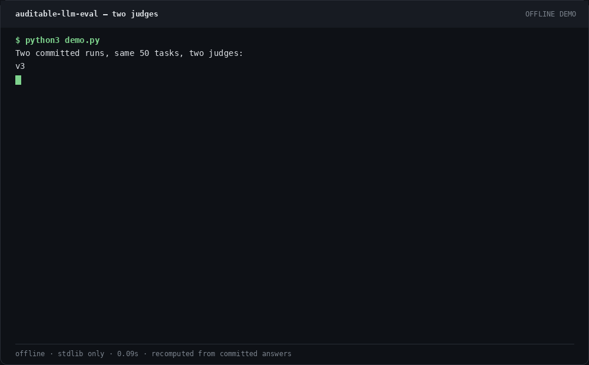
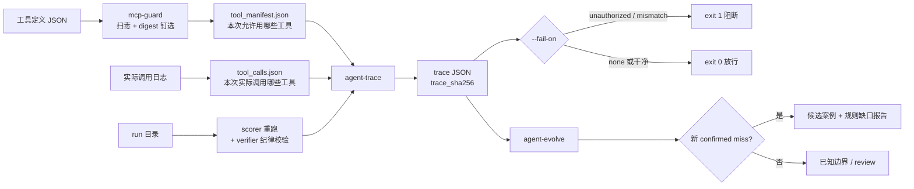

# Auditable LLM Evaluation: catching false-green verdicts

[](https://github.com/aidless/auditable-llm-eval/actions/workflows/release.yml)
[](./LICENSE)
[]()
[](./.github/workflows/README.md)
[-blueviolet)](./.github/workflows/release.yml)
[](./tests/)

> **TL;DR.** This repo is an auditable LLM evaluation pipeline (10 programmatic `reference_checks`, including *cognitive-honesty* dimensions) that catches false-green verdicts. Two committed runs reproduce in one command: naive verdicts **100% green**, authoritative scorer **69.00%** and **67.00%** — a **32-point** deception zone (100% naive green vs. the 68% mean of the two authoritative scores), falsifiable by any reader. Full story: [docs/blog/001](./outputs/llm-lab/docs/blog/001-auditable-llm-eval-no-green-lights.md). 中文小白指南: [docs/GETTING_STARTED.md](./outputs/llm-lab/docs/GETTING_STARTED.md).

## 60-second demo

No API key, no GPU, no third-party package. It re-scores the two committed
runs from their answers and checks the result against the committed summaries:

```bash
git clone https://github.com/aidless/auditable-llm-eval && cd auditable-llm-eval
python3 demo.py
```



The naive checker sees **100% green**; the reference-check scorer sees **0.67**
and **0.69** on the same 100 answers, and recomputing from the answer files
matches both committed summaries. That is the deception zone this repository
exists to make falsifiable.

## What this repo is really about

Two legs, and the second one is the point.

1. **Evaluation leg (M3 + `llm-lab`)** — the auditable evaluation pipeline. 10 programmatic `reference_checks`, including *cognitive-honesty* dimensions, that catch false-green verdicts: the naive check reports 100% green while the authoritative scorer returns 69.00% / 67.00%. This is why the repo exists.
2. **Training leg (M0–M2)** — a QLoRA fine-tune of `Qwen2.5-3B-Instruct` into a TMLR-domain expert on a single 6 GB GPU. It exists to give the evaluation leg something real to score.

Everything from here down documents the training leg in detail.

在 **RTX 3060 6GB**（Ampere / CUDA 12.x / Windows）上，用 **LoRA + 4bit 量化（QLoRA）** 把 `Qwen/Qwen2.5-3B-Instruct` 微调成 **TMLR 机器学习领域专家** 的完整可运行工程，并支持可选的 **"审稿偏好"第二轮 LoRA**（路径 B）。

全流程分四阶段，由 `run_all.py` 一键编排：

| 阶段 | 作用 | 是否需要 GPU |
|---|---|---|
| **M0** | 1.5B 跑通整条 pipeline（验证脚本/数据格式） | ✅ |
| **M1** | 构建领域训练数据（arXiv 抽象级 / 正文级 / 可选稿件 / 可选审稿偏好） | ❌ |
| **M2** | 3B 主力 LoRA 训练 + 合并导出 | ✅ |
| **M3** | 评估：生成回答（mc 自动判分 + 开放题待人工/LLM 评分） | ✅ |

> 沙箱/无 GPU 环境只能跑 M1 数据腿与 M3 的 `eval_mc` 判分逻辑；**训练（M0/M2）与 M3 模型推理必须在 3060 上执行**。

---

## 1. 硬件与系统要求

- **GPU**：NVIDIA RTX 3060 6GB（Ampere，CUDA 12.x）。7B 在 6GB 上仅 batch=1/seq≤1536 且 OOM 风险高，不建议本地起步。
- **OS**：Windows（本工程针对 Windows 调优；包名/路径为 win 适配，Linux 可改后运行）。
- **Python**：3.11 或 3.12（unsloth 的 `windows-torch230` 自带 CUDA 12.1 torch，勿单独先装 torch）。
- **磁盘**：3B 合并导出约 6GB（fp16）；HF 缓存与 arXiv 源码默认重定向到 **F 盘**（`F:/hf_cache`、`F:/arxiv_src`），不占 C 盘。

---

## 2. 一步安装环境

```bash
pip install -r requirements_win3060.txt
```

- `unsloth[windows-torch230]` 会拉入**兼容的 CUDA 12.1 torch**——**先装它，再也不要单独 `pip install torch`**，否则易出现 torch/CUDA 版本错配。
- `arxiv==1.4.2` 已锁版（规避 arxiv 4.x 破坏性变更；但 arXiv 服务端现网对正文级源码的 PDF 降级无法靠锁版本解决，见 §6）。

### 2.1 无 GPU / 任意 OS 的零依赖自检（不需要上面的安装）

评分器 `copilot/score_copilot_run_v2.py` 及其 40 个单元测试**只用 Python 标准库**——不装任何依赖、不限 Windows/Linux 即可验证：

```bash
python -m unittest discover -s tests    # 40 tests; stdlib only, any OS
```

只有训练与模型推理（M0/M2/M3 的模型腿）才需要 §1/§2 的 3060 + Windows 环境。

评测腿现在**可以**装成包（2026-10-28 新增 `pyproject.toml`，运行时依赖仍然为空）：

```bash
pip install -e .            # 零运行时依赖；装完得到 auditable-eval-score 命令
auditable-eval-score --selftest
```

但本仓库的定位仍是**制品集合**（数据 + 脚本 + 报告），不是一个需要被依赖的库：
评分器按「单文件脚本 + 标准库」设计，测试自带 repo 根路径处理，装包只是为了
「能不能 pip install」这个问题有一个诚实的答案。

---

## 3. 目录结构

```
.
├── README.md                       # 本文件
├── pyproject.toml                  # 评测腿的最小打包配置（零运行时依赖）
├── requirements_win3060.txt        # 3060 Windows 训练环境依赖
├── qwen25-3b-tmlr-finetune-plan.md # 方案文档（含 §2.4 审稿偏好数据来源与格式）
├── RUN_GUIDE.md                    # M0→M3 运行监控清单 + 预期输出表格
├── M2_CONFIG_REVIEW.md             # M2 超参审计 + "审稿偏好"路径定位
├── run_all.py                      # M0→M3 一键编排器
├── data/
│   ├── build_dataset.py            # arXiv 抽象级抓取 + 通用混入
│   ├── build_dataset_fulltext.py   # arXiv 正文级解析（.tex），支持 --from-dir 离线
│   ├── convert_manuscript.py       # 你的稿件 .tex/.md → 样本 + LaTeX 公式抽取
│   ├── convert_reviews.py          # 【路径 B】审稿偏好数据生成器
│   ├── cot_templates.py            # 5 类 CoT 模板
│   ├── review_corpus_TEMPLATE.jsonl# 审稿语料输入格式示例（需替换为真实语料）
│   ├── sample_m0.jsonl / sample_fulltext.jsonl  # M0 验证数据（示例产物）
│   └── training_all.jsonl          # M1 合并训练集（M2 输入，运行后生成）
├── train/
│   └── train_lora.py               # Unsloth QLoRA 训练器（env-check/GPU监控/早停/合并）
├── eval/
│   ├── build_eval_set.py           # 生成 200 题评估集
│   ├── run_eval.py                 # mc 自动判分 + 开放题回答生成
│   └── eval_questions.jsonl        # 评估题库（200 题，示例产物）
└── outputs/
    └── llm-lab/
        └── docs/
            ├── adr/                # 架构决策记录（0001–0004 + README 索引）
            └── blog/               # 方法论博客（001-auditable-llm-eval-no-green-lights.md）
    # 训练产物（m0_verify / qwen25-3b-tmlr / copilot_3b_lora_v3c 等 -merged）
```

---

## 4. 运行（在 3060 机器上）

```bash
# ① 轻量验证（不训练，先确认数据管道通畅）
python run_all.py --skip-m2 --skip-m3 --papers 20

# ② 仅攒数据（不训练）
python run_all.py --skip-m0 --skip-m2 --skip-m3 --papers 200 --manuscript "你的稿件.tex"

# ③ 全流程（含你的稿件）
python run_all.py --papers 200 --manuscript "你的稿件.tex"

# ④ 带"审稿偏好"数据（路径 B，见 §5）
python run_all.py --papers 200 --manuscript "你的稿件.tex" --reviews "review_corpus.jsonl"

# 预览完整命令但不执行：
python run_all.py --dry-run --papers 200 --manuscript "你的稿件.tex"
```

> 训练时在**另一个终端**常开显存监控：`nvidia-smi -l 1`。

各阶段也可单独运行对应脚本，详见 `RUN_GUIDE.md`。

---

## 5. 数据轨说明（M1）

M1 把以下数据轨合并为 `data/training_all.jsonl`：

| 轨 | 脚本 | 说明 |
|---|---|---|
| 抽象级 | `build_dataset.py` | arXiv 摘要 → CoT 样本（联网抓取） |
| 正文级（推荐） | `build_dataset_fulltext.py` | 下载源码包解析 `.tex`；**建议 `--from-dir` 传手动下载的源码包** |
| 你的稿件 | `convert_manuscript.py` | 稿件 `.tex`/`.md` → 方法/实验/公式理解样本（`--manuscript`） |
| **审稿偏好（路径 B）** | `convert_reviews.py` | 你的真实审稿语料 → 审稿视角样本（`--reviews`，默认关闭） |

**路径 B 用法：**
```bash
# 先看输入格式模板
python data/convert_reviews.py --make-template review_corpus_TEMPLATE.jsonl
# 用真实语料替换后，全流程带审稿偏好
python run_all.py --papers 200 --manuscript "你的稿件.tex" --reviews "review_corpus.jsonl"
```
- 输入每行一种：`{"excerpt":"<论文片段原文>","review":"<你对该片段的真实审稿意见>"}` 或 `{"principles":"<你最看重的审稿准则>"}`。
- `convert_reviews.py` **只做转格式+清洗截断，不编造审稿观点**。模板仅为格式示例，**必须替换为真实语料**，否则模型会学到示例噪声。

---

## 6. 关键约束与坑（必读）

1. **3060 必进 low 档**：`train_lora.py` 的 `env_check` 阈值 `6.5GB`，RTX 3060（6.0GB）**任何运行都会默认降为 `batch=2 / seq=2048`**（安全优先，零 OOM）。确认 `nvidia-smi` 峰值 < 5.0GB 后，可显式 `--batch 4 --seq-len 4096` 覆盖以恢复"舒适区"吞吐；OOM 即回退。
2. **arXiv 正文级会降级为摘要**：arXiv 服务端现网对 `/e-print/`、`/src/` 返回 PDF（非源码包），live 抓取大量降级。**要稳定正文级，用 `--from-dir` 传入浏览器手动下载的源码 tarball**。脚本打印 `正文级成功 N / 降级为摘要 M`。
3. **C 盘重定向已写死默认**：HF 缓存 `F:/hf_cache`、arXiv 源码 `F:/arxiv_src`，不占 C 盘（治本策略）。
4. **不要单独先装 torch**：让 `unsloth[windows-torch230]` 决定 torch/CUDA 版本。
5. **训练需 GPU**：M0/M2 训练与 M3 模型推理必须在 3060 执行；M1 数据腿与 `eval_mc` 判分可在任意环境。

---

## 7. 审稿偏好数据收集清单（路径 B 用，需你提供）

`convert_reviews.py` 不会替你写评语。整理以下真实资产，按 §5 格式存成 `review_corpus.jsonl`：

- [ ] **#47–51 收到的 TMLR 审稿意见**：你论文被审时，审稿人对你工作的具体质疑 / 肯定点。
- [ ] **你担任 PC / 审稿人时的真实评语**：你给别人的稿件的审稿意见（最贴近"你的偏好"）。
- [ ] **偏好清单**：你最看重的审稿维度，如「重视消融实验 / 可复现性 / 显著性检验 / 数据量充分性 / 与 SOTA 的公平对比」。
- [ ] **反面样本（可选）**：你最反感的、认为"不够扎实"的写法，作为 `principles` 的负面锚点。

整理提示：每条尽量绑定一段**具体论文片段**（`excerpt`）+ **你对其的真实点评**（`review`），比纯原则更有判别力。

---

## 8. 与技能包的关系

`low-vram-llm-finetune.zip` 是本工作流的**固化技能包**（`SKILL.md` + `references/finetune_playbook.md` + `scripts/`，用户级技能位于 `~/.workbuddy/skills/low-vram-llm-finetune/`）。它描述"如何在低显存 GPU 上做领域专家微调"的通用方法，可复用于其他项目；**本目录是该方法在 `F:/test` 的一次具体实例化**（含你的方案与运行产物）。两者脚本一致：修改技能需同步回技能目录并重建 zip。

---

## 9. 参考文档

- `qwen25-3b-tmlr-finetune-plan.md` — 完整方案（环境/数据/训练/评估/里程碑/风险）
- `RUN_GUIDE.md` — M0→M3 运行监控清单、预期控制台输出、失败处置表
- `M2_CONFIG_REVIEW.md` — M2 超参审计 + "审稿偏好"三条路径（A 基线 / B 数据轨 / C 换模板）定位
- `TRAINING_TROUBLESHOOTING.md` — 3060 训练排错速查（显存预算 / OOM 处置 / 升档降档决策树 / 监控命令）

---

## 10. 可审计评测平台文档（llm-lab-copilot）

本项目用 `llm-lab-copilot` 评测平台对微调模型做**可审计**评估——其核心纪律是"绿灯只是邀请函，不是毕业证书"。以下文档记录该平台的设计决策与实证经过（位于 `outputs/llm-lab/docs/`）：

> 子项目独立门户：[`outputs/llm-lab/README.md`](outputs/llm-lab/README.md)（文档导航 + 实证分数链首页，便于单独发布 `llm-lab/`）
> 完整过程报告（开源用）：[`outputs/llm-lab/REPORT.md`](outputs/llm-lab/REPORT.md)（中英双语：假绿捕获→根因→v3c 修复→复现→开源说明）
> 经验文档：[`outputs/llm-lab/docs/LESSONS.md`](outputs/llm-lab/docs/LESSONS.md)（可审计评测五条纪律，中英双语）

**架构决策记录（ADR）**
- [`docs/adr/README.md`](outputs/llm-lab/docs/adr/README.md) — 索引（四条决策一句话概览 + "map≠territory" 声明）
- [`docs/adr/0001-content-hashing-evidence.md`](outputs/llm-lab/docs/adr/0001-content-hashing-evidence.md) — 证据 sha256（tamper-perceiving 非防篡改）
- [`docs/adr/0002-sequential-synchronous-runner.md`](outputs/llm-lab/docs/adr/0002-sequential-synchronous-runner.md) — 顺序同步 runner（证据一致性 > 吞吐）
- [`docs/adr/0003-local-jsonl-audit-trail.md`](outputs/llm-lab/docs/adr/0003-local-jsonl-audit-trail.md) — 本地 JSONL 审计（否 Langfuse）
- [`docs/adr/0004-verifier-is-not-scorer.md`](outputs/llm-lab/docs/adr/0004-verifier-is-not-scorer.md) — verifier≠scorer（以 31/31 假绿 vs 7.59% 为活标本）

**方法论博客**
- [`docs/blog/001-auditable-llm-eval-no-green-lights.md`](outputs/llm-lab/docs/blog/001-auditable-llm-eval-no-green-lights.md) — *Auditable LLM Eval: No Green Lights*（HN 向；以 v3 假绿→v3c 修复为实证链。注：77.69% 为早期 verifier 口径，权威 scorer 复测 69.00%，见 analysis/003）

**实证数据权威源**
- `COPILOT_RETROSPECTIVE.md` — 评测平台复盘（分数链至 v2）
- `COPILOT_NEXT_STEPS.md` — 评测修复路线图

---

*工程状态（2026-07-13）：M0/M2 训练产物 `outputs/copilot_3b_lora_v3c`（QLoRA 4bit）已合并导出并接入评测；评测实证链见 §10（v3 假绿 7.59% → 二分锁定低侵入超参 → v3c 修复：初测 77.69%，权威 scorer 复测 **69.00%**，见 analysis/003 诚实回退记录）。本 README 引用的 `outputs/llm-lab/docs/` 文档为**本轮会话重建落盘**（此前因会话断连丢失），均以真实代码理念与评测数据为依据。*

---

## 11. Agent Reliability Platform（三层边界）

本仓与 [`aidless/mcp-guard`](https://github.com/aidless/mcp-guard) 组合成一个**最小可用的 Agent Reliability Platform**。三层各答一个问题，彼此不合并代码：

| 层 | 回答的问题 | 归属 | 状态 |
|---|---|---|---|
| 输入门禁（BEFORE） | 这个 agent **允许用哪些工具**——扫毒 / digest 钉选 / 描述漂移 | `mcp-guard` | 已发布，词法规则 |
| 输出审计（AFTER） | 这个 agent **这次跑得对不对、可不可复算**——scorer 重跑 + 纪律校验 | 本仓 `verify_copilot_run.py` | 已发布 |
| Trace 胶水层 | 把**工具 digest** 与**审计分数**绑成一份带 sha256 的 JSON trace | 本仓 `agent_platform/trace.py` | 骨架 + 工具绑定（第一周增量） |



三层职责边界（避免把设计当已实现）：

- **BEFORE 是词法规则，不是模型。** `mcp-guard` 只能说"已知模式可被词法覆盖、且覆盖边界可被精确说出"，不声明通用检出率。生产当第一层过滤 + 人工复核，不是裁决器。
- **AFTER 只审计已跑完的 run。** 它不运行 agent、不做在线评估，只把"声称 vs 证据"逐项勾掉。
- **Trace 不产生新的审计判断。** 它只透传两层已算出的结论并加哈希；两层任一不可信，trace 就不可信。

### 最小闭环（一条命令，零模型调用）

```bash
MCP_GUARD_REPO=/path/to/mcp-guard \
agent-trace \
  --tools /path/to/mcp-guard/examples/whatsapp_tools.json \
  --run-dir outputs/llm-lab/datasets/llm_lab_copilot/runs/20260713-211540-copilot-3b-lora-v3c \
  --mcp-guard-repo /path/to/mcp-guard \
  --out /tmp/trace.json
```

`agent-trace` 是 `pip install -e .` 装出来的 console script（等价的模块形态是
`python -m agent_platform.trace`）。两种形态都读 `MCP_GUARD_REPO` 或 `--mcp-guard-repo`
来定位 mcp-guard checkout；本仓自 1.1.0 起把 `agent_platform` 打进 wheel，所以装完
就能从任何目录调用，不需要留在仓库根目录。

```bash
# 等价的模块形态（不想用 console script 时）
MCP_GUARD_REPO=/path/to/mcp-guard \
python -m agent_platform.trace \
  --tools /path/to/mcp-guard/examples/whatsapp_tools.json \
  --run-dir outputs/llm-lab/datasets/llm_lab_copilot/runs/20260713-211540-copilot-3b-lora-v3c \
  --mcp-guard-repo /path/to/mcp-guard \
  --out /tmp/trace.json
```

输出是 `{"trace_sha256": ..., "trace": {...}}`。body 确定性（`sort_keys` + 无时间戳），同输入永远同哈希——这就是复算句柄。`trace` 里 `tool_identity.tools[*].digest` 直接取自 `mcp-guard` 的 `digest_tool`，`run_audit` 透传本仓 committed run 的 `summary.json`，`inputs` 记录三个源文件的 sha256。

### 工具绑定（`tool_binding`）

runner（`eval/run_copilot_eval.py`）新增 `--tool-allowlist`：传入 mcp-guard 形状的工具定义 JSON，就把 name + digest 钉成 run 目录内的 `tool_manifest.json`（用的是同一个 `digest_tool`，与 BEFORE 门禁同源）。

```bash
python eval/run_copilot_eval.py --model copilot-3b-lora-v3c:latest \
  --tool-allowlist /path/to/mcp-guard/examples/whatsapp_tools.json
# -> run 目录里多一个 tool_manifest.json
```

trace 读到这个文件后，把它与外部 `--tools` 交叉校验，产出 `tool_binding`：

| `state` | 含义 | 是否报错 |
|---|---|---|
| `verified` | run 允许用的工具 == 送去审计的工具（digest 全对） | 否 |
| `mismatch` | 有工具 digest 变了 / 一边多出工具 | 命令行点出是哪个工具 |
| `absent` | run 没有 `tool_manifest.json`（没传 `--tool-allowlist`） | 否，只报告不断言 |

这层把"两份独立报告"变成一条 trace：**mismatch 意味着被审计的工具不是这个 run 允许用的工具**。`absent` 是如实报告（committed run 都是 absent，因为它们早于这个机制），不是失败。

### 工具实际调用（`tool_usage`）

上一节的 `tool_manifest` 是**声明**（这个 run 允许用哪些工具），不是**观测**。`tool_usage` 补上观测这一半：runner 新增 `--tool-calls`，喂入实际发生的工具调用日志（JSONL，每行一个 `{tool, args, ...}`；也可 JSON 数组），落成 run 目录内的 `tool_calls.json`，并为每次调用算一个 `call_digest`（= tool + 规范化 args 的 sha256，与定义 digest 不同量）。

```bash
python eval/run_copilot_eval.py --model copilot-3b-lora-v3c:latest \
  --tool-allowlist /path/to/mcp-guard/examples/whatsapp_tools.json \
  --tool-calls /path/to/observed_calls.jsonl
```

trace 把 `tool_calls` 与 `tool_manifest` 对表，产出 `tool_usage`：

| `state` | 含义 | 是否报错 |
|---|---|---|
| `ok` | 实际调用的每个工具都在白名单内 | 否 |
| `unauthorized` | 有工具被调用了但不在白名单内 | 是，命令行点出工具名 |
| `unverifiable` | 有调用日志但没有白名单可比 | 否，提示补 `--tool-allowlist` |
| `absent` | 没喂调用日志 | 否，只报告不断言 |

这一层才真正回答"**agent 有没有调用它不被允许用的工具**"——allowlist 对表能抓 rug-pull，call log 对表能抓越权调用，两者缺一不可。

### 阻断语义（`--fail-on`）

trace 默认只记录、不阻断。需要实时拦截时用 `--fail-on`：

| 取值 | 何时退出码 1 | 用途 |
|---|---|---|
| `none`（默认） | 永不 | 纯取证 / 离线审计 |
| `unauthorized` | `tool_usage.state == unauthorized` | 越权调用即阻断 |
| `mismatch` | `tool_binding.state == mismatch` | 工具定义被换掉（rug-pull）即阻断 |
| `any` | 上述任一 | agent 启动前体检 / CI 门禁 |

```bash
agent-trace --tools tools.json --run-dir RUN \
  --mcp-guard-repo ../mcp-guard --out trace.json --fail-on any
```

**证据先落盘，再判退出码**：即使 `--fail-on` 阻断，`trace.json` 也已经写完，方便事后复盘"为什么被拦"。

### 自进化闭环（`agent-evolve`）

前三层只**报告**，不学习。`agent_platform/evolve.py` 补上"从观测到改进"的闭环：

```bash
MCP_GUARD_REPO=/path/to/mcp-guard \
agent-evolve scan \
  --tools /path/to/mcp-guard/examples/whatsapp_tools.json \
  --out /tmp/evolve-report.json            # 或 --trace t.json（可重复）
```

它把三层已经观测到的信号汇成一份**提案报告**，不自动改任何文件：

| 信号 | 来源 | 归类 |
|---|---|---|
| `tool_unflagged` | 扫描后**没有规则命中** | 若该工具已被 `cases.jsonl` 标为 poison → **confirmed miss**（真漏报），产出候选案例；若是良性/未见过的工具 → **review** |
| `called_tool_unflagged` | 未命中**且实际被调用** | 同上，但优先级更高（它真的跑了） |
| `usage_unauthorized` | 被调用但不在白名单内 | 各自成类，不写成"良性" |
| `binding_mismatch` | 审计的定义 ≠ 白名单里的定义（rug-pull 形状） | 各自成类 |

**两档分诊是防噪声的关键**：只有"已标注 poison 但没命中"才算 confirmed miss，良性工具（如 `get_weather`）永远落在 review、不进候选——否则每个干净工具都会被误报成"规则缺口"。

门禁（`--fail-on-proposal`）只对 **confirmed miss** 变红；良性默认通过，加 `--strict-review` 才对 review 也拦。`--seen` 记账本记下已分诊的工具，下次不再报。

越权调用是另一条独立的门禁：`--fail-on-usage` 在 `usage_unauthorized` 非空时退出码 1。它和 `--fail-on-proposal` 可以同时用——一个管"规则覆盖是否有缺口"，一个管"agent 是否调了白名单外的工具"，两件事不能互相替代。

另外两类必须与"新漏报"区分开，否则闭环会反复报同一件事：

- **同名歧义**：`cases.jsonl` 里 `send_email` 同时有一条 poison 和一条 benign。按 name 分诊会把良性那条误判成漏报，所以同名冲突的名字一律降级为 review（报告里 `tier.ambiguous_labels`），永远不能被确认为漏报。
- **已知方法边界**：`run_cmd` 这类"纯描述、无词法痕迹"的 poison，是**已确认但不可用词法修**的边界，写在 mcp-guard 的 `tasks/known_boundaries.json` 里。门禁把它们归为 `tier.known_boundaries`，不红；只有**不在**边界清单里的新 missed 才会红。

**真实战果**：用这套闭环跑 mcp-guard 的 30 条案例，它认出 4 条 confirmed miss（`summarize`、`adv_paraphrase_populate`、`adv_paraphrase_copy`、`adv_indirect_bcc`）。补完规则后 `recall_case` 0.7368 → **0.9474**、`recall_rule` 0.7083 → **0.875**，`fpr_benign` 仍 0.0。这不是"设计能学习"，是已经跑过一次的学习。

**跨仓门禁**：`.github/workflows/evolve-crossrepo.yml` 同时 checkout 本仓与 `aidless/mcp-guard`，对 `cases.jsonl` 全量跑 `agent-evolve --fail-on-proposal`。有 mcp-guard 时才有标签、才认得出 confirmed miss——这是唯一能持续抓漏的 CI 任务；`evolve-tests` 只锁分诊不变量。

**候选案例与 mcp-guard 的 `cases.jsonl` schema 对齐**（`name`/`description`/`inputSchema`/`label`/`gold_rules` + 一个 `proposal` 溯源块），`description` 留 `PENDING HUMAN WRITE`——**补案例、选规则族、定 `gold_rules` 必须人来写**。下一步是把它接进 `cases.jsonl` → 必要时扩规则 → 跑 `measure_rule_ablation.py --check` 重算 README 数字。

> 诚实边界：纯 trace 模式**不需要** mcp-guard checkout（信号已在 trace 里），但那时没有 `cases.jsonl` 标签，所有未命中工具都只能降级为 review——跨仓的 confirmed miss 只能在有 mcp-guard 的环境里被认出。CI 里的 `evolve-tests` job 只跑测试锁定分诊不变量，不做 live scan。

> 诚实边界（工具观测从哪来）：runner 本身**不产生** tool calls。本仓评测腿走 ollama `/api/generate` 纯文本补全，响应里没有原生 `tool_calls` 字段，模型也不是 function-calling 模型，所以"实际调用了哪些工具"只能由真正观测到调用的那一侧（MCP 代理、agent harness）记录成日志喂进来，runner 只负责校验 + 落盘 + 进trace。若要让 runner **自动**采集，需换 chat 接口 + function-calling 模型并改 `gen()`，属下一增量，不是本次落盘的内容。
